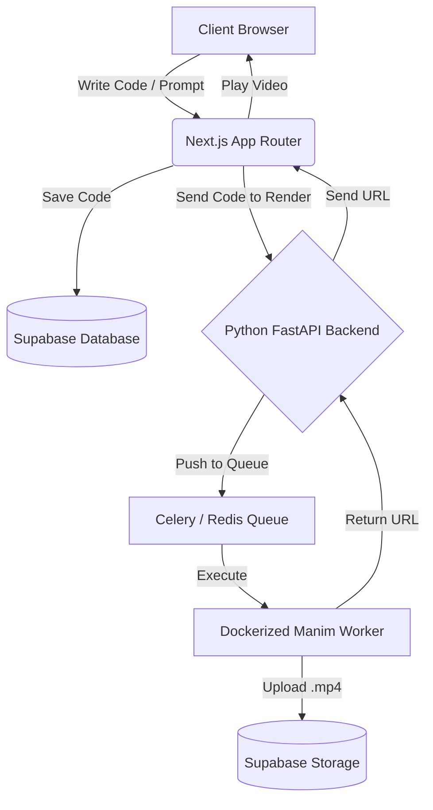

# Manim Code Editor

A stunning, AI-powered web editor for writing, rendering, and tweaking [Manim](https://www.manim.community/) animations straight from your browser. Inspired by the educational beauty of 3Blue1Brown, this platform bridges the gap between writing complex math animations and rendering them seamlessly.

## 🚀 Features (Frontend)
- **Glassmorphism UI**: Beautiful, dark/light adaptive user interface leveraging Tailwind CSS v4.
- **Floating Backgrounds**: Interactive math and code elements floating seamlessly in the background.
- **Monaco Code Editor**: VS-Code-like editing experience with syntax highlighting (coming soon).
- **Live Preview**: See the output `.mp4` Manim animations instantly after rendering.
- **AI Creator**: An AI-assisted chat interface to help generate Manim code from natural language prompts.

## 🏗️ Architecture Flow

This project uses a dual-architecture setup to separate the lightweight frontend from the heavy Python rendering engine.



### 1. Frontend: Next.js (App Router)
- Handles user authentication, project saving, and the beautiful interactive UI.
- Deployed on **Vercel** (Serverless, globally distributed).

### 2. Backend: Python FastAPI & Manim
- Manim requires `ffmpeg`, `LaTeX`, and `libcairo`. These dependencies are heavy and cannot be run on Vercel's edge network.
- We use a **Dockerized Python Backend** running FastAPI to receive render requests.
- Uses **Celery + Redis** to handle concurrent users rendering at the same time without crashing the server.
- Deployed on a **DigitalOcean Droplet** (Virtual Machine).

### 3. Database & Storage: Supabase
- Acts as our PostgreSQL database for saving user projects and credentials.
- Uses **Supabase Storage** to store the rendered `.mp4` video outputs.

## 🛠️ GitHub Student Developer Pack Benefits
This project is strategically designed to utilize the GitHub Student Developer Pack for 100% free hosting:
1. **DigitalOcean**: Use the $200 platform credit to spin up the Ubuntu Droplet that will host the heavy Dockerized Manim rendering backend.
2. **Namecheap / Name.com**: Use the 1-year free domain registration to give this project a custom domain name (e.g., `manimeditor.me`).
3. **Frontend**: Vercel provides free frontend hosting.
4. **Database**: Supabase provides a generous free tier.

## 📂 Folder Structure

```
.
├── app/                  # Next.js 15 Frontend
│   ├── src/app/          # App Router Pages (Editor, Creator, Auth)
│   ├── src/components/   # Reusable UI Components
│   ├── public/           # Static Assets
│   └── package.json      # Frontend Dependencies
│
├── backend/              # Python FastAPI Rendering Server (Upcoming)
│   ├── main.py           # API endpoints
│   ├── worker.py         # Celery tasks for executing manim
│   └── Dockerfile        # Container with FFmpeg, LaTeX, and Manim
│
├── .gitignore
└── README.md
```

## 💻 Getting Started (Local Development)

### Frontend
1. Navigate to the frontend directory: `cd app`
2. Install dependencies: `npm install`
3. Run the dev server: `npm run dev`
4. Visit `http://localhost:3000`

### Backend (Coming Soon)
*(Detailed instructions for spinning up the Dockerized FastAPI backend will be added in Phase 9).*
