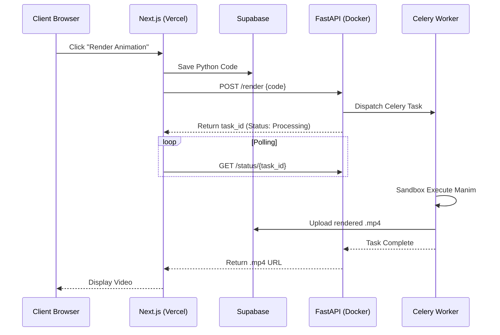

# Manim Code Editor

A sophisticated web-based environment for developing, rendering, and refining Manim animations directly from your browser. Inspired by 3Blue1Brown, this platform provides a seamless experience for creating complex mathematical animations without the overhead of local environment configuration.

## Overview

Manim Code Editor bridges the gap between writing Python animation scripts and rendering them. It features an intelligent dual-architecture system designed for scalability, pairing a lightweight, globally distributed frontend with a robust, asynchronous Python rendering engine.

### Frontend Features

* **Glassmorphism Interface**: A modern, adaptive user interface built with Tailwind CSS v4, supporting both light and dark themes.
* **Integrated Editor**: A VS Code-style editing environment utilizing Monaco Editor for Python syntax highlighting and code completion.
* **Instant Preview**: Seamlessly view rendered `.mp4` Manim outputs directly within the workspace.
* **AI Assistance**: An integrated AI chat interface designed to help generate and modify Manim code from natural language prompts.

## Architecture & Technical Deep Dive

For contributors, understanding how the pieces fit together is crucial. Manim Code Editor uses a **dual-architecture setup** to solve a specific problem: Manim is a heavy Python library that requires system-level dependencies (FFmpeg, LaTeX, Cairo), which makes it impossible to run in standard serverless environments (like Vercel or AWS Lambda).

To solve this, we decoupled the application into two distinct environments.



### 1. The Frontend (Next.js App Router)
* **Hosting:** Vercel (Edge Network)
* **Purpose:** Handles the user interface, authentication, and state management. Because it's deployed on Vercel, it scales infinitely and handles traffic spikes effortlessly.
* **Key Components:**
  * Uses **Monaco Editor** for the code editing experience.
  * Polls the backend when a render is requested to update the UI with progress.

### 2. The Rendering Engine (Python FastAPI + Celery)
* **Hosting:** Dockerized environment on a dedicated VPS (e.g., DigitalOcean).
* **Purpose:** Safely executes user-submitted Python code and generates animations.
* **The "Traffic Jam" Problem:** Rendering video is CPU-intensive. If 50 users click "Render" simultaneously, a standard API would crash. 
* **The Solution:** 
  * The **FastAPI** server instantly accepts the request and places it into a **Redis Queue**.
  * A **Celery Worker** picks up jobs one by one (based on CPU availability), ensuring the server never runs out of memory.
  * We enforce **Code Sandboxing** (stripping out dangerous imports like `os` or `subprocess`) and **Timeouts** to prevent malicious code execution.

### 3. Database & Storage (Supabase)
* **PostgreSQL:** Stores user accounts, OAuth identities, and saved project code.
* **Storage Buckets:** Holds the final `.mp4` files generated by the Celery worker, serving them back to the Next.js frontend via a public URL.

## Directory Structure

```
.
├── app/                  # Next.js 15 Frontend
│   ├── src/app/          # App Router Pages (Editor, Creator, Auth)
│   ├── src/components/   # Reusable UI Components
│   ├── public/           # Static Assets
│   └── package.json      # Frontend Dependencies
│
├── backend/              # Python FastAPI Rendering Server
│   ├── main.py           # API endpoints and rate limiting
│   ├── worker.py         # Celery tasks for executing manim safely
│   ├── requirements.txt  # Python dependencies
│   └── docker-compose.yml# Container orchestration
│
├── .gitignore
└── README.md
```

## Getting Started (Local Development)

### Frontend Setup

1. Navigate to the frontend directory:
   ```bash
   cd app
   ```
2. Install dependencies:
   ```bash
   npm install
   ```
3. Run the development server:
   ```bash
   npm run dev
   ```
4. Access the application at `http://localhost:3000`.

### Backend Setup

1. Navigate to the backend directory:
   ```bash
   cd backend
   ```
2. Start the Docker containers (FastAPI, Celery, Redis):
   ```bash
   docker-compose up --build
   ```
3. The API will be available at `http://localhost:8000`.

## Contributing

I welcome contributions to the Manim Code Editor! Please follow these steps to contribute:

1. Fork the repository.
2. Create a new branch for your feature or bug fix: `git checkout -b feature/your-feature-name`.
3. Commit your changes with clear, descriptive messages: `git commit -m 'Add some feature'`.
4. Push to your branch: `git push origin feature/your-feature-name`.
5. Open a Pull Request against the `main` branch.

Please ensure your code follows the existing style and includes appropriate documentation.

## Reporting Issues

If you encounter a bug, have a feature request, or need help, please open an issue in the GitHub repository. When submitting an issue, please include:

* A clear and descriptive title.
* Steps to reproduce the issue (if reporting a bug).
* Details about your environment (OS, browser, etc.).
* Any relevant error logs or screenshots.

## License

This project is open-source and available under the MIT License.
